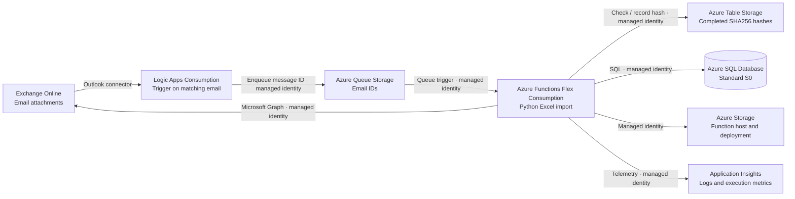

# Azure Functions showcase

A technical demo of importing Excel email attachments into Azure SQL with Python. Logic Apps queues the email ID; an Azure Function reads `attachment.xlsx` through Microsoft Graph and writes each data row into SQL. Table Storage records completed attachment hashes. The design uses only managed services, with no virtual machines, and keeps the Python step open for enrichment before rows reach SQL.

## Overview



## Exchange Online

A dedicated mailbox receives emails with attachments in the agreed format. The Office 365 Outlook connector uses an authorized Microsoft 365 user connection to access the mailbox through its current email-arrival trigger.

## Logic Apps Consumption

The workflow selects emails with the configured subject and posts only the email ID to Storage Queue using its managed identity. It finishes when the queue accepts the message, independently of processing time. Attachment contents never pass through the workflow. Consumption pricing charges for trigger and action executions.

## Azure Queue Storage

The queue holds email IDs until the Function processes them. Failed invocations are retried; messages that repeatedly fail move to `email-imports-poison`. After correcting the cause, copy the poison message back to `email-imports` unchanged and remove the poison copy using Storage Explorer. Keep the source email available and unmoved until processing completes.

## Azure Functions Flex Consumption

A queue-triggered Python Function downloads matching `attachment.xlsx` files through Microsoft Graph, computes each file's SHA256, and skips completed hashes found in Table Storage. New files are validated and imported in one SQL transaction, then marked complete in Table Storage. Exceptions fail the invocation so the queue runtime retries it. There is no HTTP import endpoint. Compute scales to zero between runs, with no always-ready instances.

## Azure Table Storage

The table stores each completed attachment's SHA256 as its row key, along with the SQL import identifier, row count, and completion time. Deduplication is by file contents, so a byte-identical file received in another email is skipped. Completion is recorded after SQL commits. SQL also guards imports by hash so concurrent deliveries or a crash between the SQL commit and Table write cannot duplicate rows.

## Azure SQL Database Standard S0

The database stores one SQL row per Excel data row, with its named values in a JSON column, plus an import receipt containing the content hash. This preserves an attachment's column names without a fixed schema per workbook layout. S0 has a recurring cost even when idle. The Function can execute the import procedure but cannot directly read or modify tables.

## Azure Storage

Queue Storage, Table Storage, the Function host's state, and the deployment package share one storage account. All connections use managed identity authentication rather than storage account keys.

## Application Insights

Application Insights records Function logs, execution times, and failures. Each processed attachment is logged with its content hash, result, row count, and queue message ID. The queue ID also appears in the Logic Apps enqueue response. Telemetry ingestion uses managed identity authentication; application logs exclude attachment contents.

## Microsoft Entra ID and managed identities

The Logic App's identity can send messages to the input queue. A separate Function identity processes the queues and accesses Microsoft Graph, SQL, the completed-hash table, and Application Insights. Its Graph permission is the `Mail.Read` application role, which covers every mailbox in the tenant. To limit it to the demo mailbox, replace the Entra grant with an Exchange [RBAC for Applications](https://learn.microsoft.com/en-us/exchange/permissions-exo/application-rbac) assignment of the `Application Mail.Read` role scoped to that mailbox. The Outlook connector's Microsoft 365 user connection is the exception to managed identity authentication.

## Deploy

Install Azure CLI, Azure Functions Core Tools, and [uv](https://docs.astral.sh/uv/); on macOS also `brew install openssl@3` for the SQL driver. Sign in with `az login` as a user or service principal who can create resources, assign Azure roles, and grant application permissions to Microsoft Graph. That principal becomes the SQL Entra administrator and can inspect the hash table and manage the queues. The script targets the subscription you specify and creates billable resources.

```sh
./setup.sh deploy \
  --subscription YOUR_SUBSCRIPTION_ID \
  --resource-group rg-azure-functions-showcase \
  --mailbox demo@example.com
```

The script deploys Bicep, initializes SQL, grants the Function access to SQL and to the mailbox, and publishes the Python code using a Linux remote build. No Function API application registration is needed. The workflow stays disabled during setup. Re-running deployment updates the resources and disables the workflow again without deleting imported rows.

Open the Outlook API connection using the portal link printed by the script. Select **Edit API connection → Authorize**, sign in as the user of the mailbox given in `--mailbox`, and save. Then enable the workflow:

```sh
./setup.sh enable \
  --subscription YOUR_SUBSCRIPTION_ID \
  --resource-group rg-azure-functions-showcase
```

The demo uses SQL's public endpoint with **Allow Azure services** enabled. This firewall rule admits connections from other Azure tenants too; Entra-only authentication and database permissions still enforce access. Setup temporarily allows your public IPv4 address for SQL initialization and removes that rule afterward. The machine running setup needs outbound SQL connectivity on port 1433.

## Run the demo

```sh
uv run --no-project --python 3.12 --with-requirements requirements.txt python examples/create_workbook.py
```

Send the generated `examples/attachment.xlsx` to the connected mailbox with the subject **Azure Functions showcase**. Send a new email after enabling the workflow; setup does not backfill old messages. The sample contains three rows with values 10, 20, and 30.

In Logic Apps run history, confirm that **Enqueue_email** succeeds. This confirms submission; the Function completes asynchronously. Application Insights should then show `imported` with `rows=3`, and Table Storage should contain the attachment's hash. Resubmit the workflow or send the same file in another email: the Function should log `already_processed`, with no extra SQL rows. Invalid workbooks fail processing without a partial SQL import and eventually reach the poison queue.

Run the SQL queries in `examples/results.sql` as the SQL Entra administrator to inspect rows and calculate statistics. The sample gives a sum of 60, mean of 20, and sample standard deviation of 10. Azure SQL's query editor or a SQL client can use your Entra sign-in; local clients also need a firewall rule for their address.

## Cost estimate

Assumptions: 100 emails per day with one `attachment.xlsx` each (about 3,040 per month), pay-as-you-go list prices for germanywestcentral from the [Azure Retail Prices API](https://learn.microsoft.com/en-us/rest/api/cost-management/retail-prices/azure-retail-prices) on 2026-10-25 in USD, no free grants. Function runs measured 0.15 to 0.7 seconds in the live test; the estimate budgets 1 second at 2 GB per run.

| Service | Price basis | Per month |
|---|---|---|
| Azure SQL Database S0 | $0.4839 per day | $14.72 |
| Logic Apps Consumption | $0.000125 per Outlook trigger call + $0.000031 per built-in action | $0.47 |
| Azure Functions Flex Consumption | $0.000037 per GB-second + $0.40 per million executions | $0.23 |
| Log Analytics | $2.99 per GB ingested; a few KB per run | under $0.20 |
| Storage (queue, table, blob) | $0.0035 per 10,000 queue operations, $0.0596 per GB-month | under $0.05 |
| Managed identities, Entra permissions | no charge | $0 |

Total about $16 per month, of which the database is over 90 percent. The database cost is fixed; the other items scale linearly with email volume.

## Workbook contract

The first worksheet contains column names in row 1 and data underneath. Column names must be unique, non-empty text. Empty data rows are skipped, missing values become JSON null, dates/times become ISO strings, and durations become seconds. Numeric and Boolean values retain their types; Excel number formatting is not retained. Formula and error cells are rejected: export calculated values before sending. Other worksheets are ignored. A renamed legacy `.xls` file is not supported.

## Verification

```sh
az bicep build --file infra/main.bicep --stdout > /dev/null
./setup.sh verify \
  --subscription YOUR_SUBSCRIPTION_ID \
  --resource-group rg-azure-functions-showcase
```

Live verification reports queue lengths, completed hash entries, SQL import and row counts, and recent workflow runs. An empty queue alone does not prove successful processing: check the poison queue, hash entry, and SQL results too. Use the sample-email walkthrough above to verify the complete pipeline and retry behavior.

To stop charges, delete the dedicated resource group. This removes the Function identity and its Graph permission grant.
